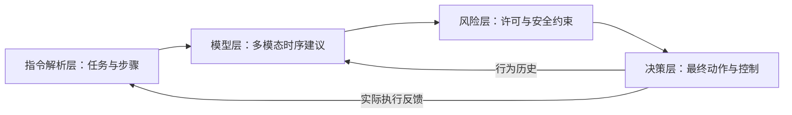

# 5 分钟答辩：四层代码链路与创新

南京大学团队 | V140 | 6 页 PPT 内容与备查信息 | 总计约 300 秒

## 01 / 简要介绍：整条链路与 PPT 结构

建议用时：40 秒。先说明系统如何工作，再交代后面只讲四个层级。

### PPT 页面内容

**目标：把自然语言驾驶指令转化为安全、连续、可追溯的车辆行为。**

语音/文本提供任务；RGB、LiDAR、雷达与车况提供观测。风险层独立核对当前证据，决策层执行后回传真实状态。

| PPT 顺序 | 内容 | 用时 |
| --- | --- | --- |
| 1 | 简要介绍：整体链路与四层结构 | 40 秒 |
| 2 | 指令解析层：理解任务与动作顺序 | 50 秒 |
| 3 | 模型层：多模态、时序记忆与轻量化 | 70 秒 |
| 4 | 风险层：检查当前是否允许执行 | 60 秒 |
| 5 | 决策层：把建议落成连续驾驶动作 | 55 秒 |
| 6 | 结果与总结 | 25 秒 |

<!-- page -->

## 02 / 指令解析层：把一句话变成任务图

建议用时：50 秒。核心问题：**做什么，按什么顺序做？**

### PPT 页面内容

输入：自然语言文本。输出：驾驶意图、参数与带依赖关系的步骤图。

1. 保留动作、方向、速度及“先后/条件”关系，避免复合指令只执行首动作。
2. 歧义或步骤不完整时要求澄清，不继续执行残缺计划。
3. 下一步由真实驾驶完成反馈触发，而不是由模型“说已完成”触发。

**示例（用于解释结构）：先减速礼让 → 确认安全后左变道 → 超越后恢复巡航。**

**本层改进：组合解析优先 + 依赖完整性检查 + 语义与实际执行对齐。**

### 组员备查（不在台上展开）

入口：`structured_command_parser/src/`；计划衔接：`lightweight_vla_adapter/src/driving_plan_runtime.py`。历史依据：`docs/COMPOUND_PLAN_ENTRY_20260930.md`。语言编码是既有能力，不称为本轮新发明；开发伪标签一致性不代替独立语义准确率。

<!-- page -->

## 03 / 模型层：多模态时序建议与资源优化

建议用时：70 秒。核心问题：**看到了什么，接下来怎样驾驶？**

### PPT 页面内容

输入：语言特征、四视角 RGB、物理 LiDAR、雷达与车况。输出：动作/速度建议、风险特征及短期纵向参考。

1. **多模态融合：** 结合驾驶任务与当前环境，不只按文字选择动作。
2. **分层时序：** 事件历史、行为分段和递归状态保留上下文；30 点速度/加速度参考覆盖 3 秒，并滚动重规划。
3. **轻量化候选：** 常量输入特化、GroupNorm 整组剪枝与蒸馏、敏感模块混合 INT8。

**本层创新重点：任务相关的时序记忆 + 运动学一致的短期纵向参考。**

组件候选结果：FLOPs 比值 0.495118；CPU P95 86.509 → 51.856 ms；混合量化动作代理指标相对衰减 2.22%。这些不是最终整链路部署收益。

### 组员备查（不在台上展开）

入口：`lightweight_vla_adapter/src/decision_adapter.py`、`event_memory.py`、`behavior_memory.py`、`sequence_policy.py`。优化证据见性能报告。当前没有同条件闭环消融证明记忆独立提升多少，也没有板端实测支持“全链路 9 ms”。

<!-- page -->

## 04 / 风险层：有建议，不等于可以执行

建议用时：60 秒。核心问题：**当前允许做吗，依据是否可靠？**

### PPT 页面内容

输入：模型建议与当前感知/道路证据。输出：允许、限速、等待或阻断，以及对应原因。

1. **风险与许可分离：** 风险分数低，不代表可以跨实线或闯红灯；前方障碍与后方接近分别处理。
2. **证据必须新鲜：** 当前图像识别灯色；静态地图只提供灯组、停止线和车道几何。未知不当作绿灯或净空。
3. **保护可追溯：** 保留碰撞、明确停车和运行异常保护，记录建议被改写或阻断的原因。

**本层改进：任务可行性契约 + 当前证据校验，让安全约束与模型建议协同。**

### 组员备查（不在台上展开）

入口：`task_feasibility.py`、`lane_risk_contract.py`、`longitudinal_contract.py`、`traffic_control_contract.py`（`lightweight_vla_adapter/src/`）。信号观察器：`experiment/CARLA/control/map_signal_observer.py`。有限仿真中的零违规不等于普遍安全证明。

<!-- page -->

## 05 / 决策层：把约束后的建议变成真实动作

建议用时：55 秒。核心问题：**怎么做，做到哪一步了？**

### PPT 页面内容

输入：当前任务、模型建议、风险许可与执行状态。输出：最终驾驶动作及油门/制动/转向，并回传完成证据。

1. **统一选择：** 主控制器综合任务步骤与安全约束，选择当前实际动作。
2. **连续执行：** 行为 FSM 管理变道阶段和目标车道，路线 PID 完成连续跟踪；居中稳定后再向导航交接。
3. **反馈与恢复：** 实际下发行为更新记忆；普通任务失败与继续导航分离，原始失败仍保留。

**本层改进：拓扑身份保持 + 变道/巡航交接 + 真实反馈闭环。**

### 组员备查（不在台上展开）

入口：`experiment/CARLA/universal_vla_controller.py`；`control/generic_instruction_fsm.py`、`generic_route_pid.py`、`command_dispatch.py`。最终 full41 的失败退休数为 0，不声称该次全程依赖退休机制完成。

<!-- page -->

## 06 / 结果与总结：一条闭环，三个重点

建议用时：25 秒。数字用于收尾，不再展开新模块。

### PPT 页面内容

| 场景 | 路线 | 文本至控制 P95 |
| --- | --- | --- |
| 一 | 4997.06 m | 148.857 ms |
| 二 | 8001.023 m，原始起点连续到终点 | 140.828 ms |
| 三 | 5999.96 m | 103.940 ms |

**三个重点：任务与执行对齐；多模态时序建议；安全约束下的连续决策。**

场景二原始严格结果 11/15；另有 4 条按实际驾驶及放宽判据补充复核通过。合并工程口径为 15/15，不是官方严格全通过或独立语义准确率 100%。

### 仅供追问时说明

时延不含 ASR，P95 达标不代表每帧达标。场景二原始 `CHECK_FAILED` 和退出码 2 不改写；02/03/04/11 的补充通过均另有证据及调整口径。压缩是组件候选结果，最终连续闭环使用完整 FP32 时序模型。完整证据见本目录 `PERFORMANCE_REPORT.md/.pdf` 和 JSON。

本版将原详细指南精简为六页、四层结构。代码入口仅供备查，不逐文件讲解。

建议按时间表排练，再根据实际语速微调。
