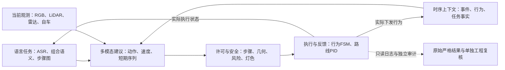

# 挑战赛道：分层代码链路与创新答辩指南

南京大学团队 | 组内阅读与答辩准备 | 2026-10-10 / V140

## 01 / 先把我们的系统讲成一条闭环

本指南以 `challenge-track` 的已核对源码为准：文档基线 `e92c3c74`，最终赛道源码归档提交 `3cc601f5`；运行源码身份以 `source_files_sha256.json` 的 852 项指纹为准。它解释代码与历史改进，不新增测试，不修改原始评测结果。

**核心表述：我们构建的是语言条件下、带多模态时序记忆和可执行安全约束的分层驾驶闭环。** 语言模块回答“做什么、按什么顺序做”；感知回答“现在看到了什么”；时序模块回答“发生过什么、接下来如何调速”；执行层回答“当前能否安全做、实际做到了哪一步”。

不要把整条链路说成“大模型直接输出方向盘”。神经网络输出驾驶建议和短期纵向参考，指令图、状态机、风险契约、信号约束和路线 PID 共同决定实际控制。

### 阅读标记

| 标记 | 含义 | 答辩使用原则 |
| --- | --- | --- |
| 最终链路 | 最终源码中实现或接入的能力 | 配置开关与实际运行仍需区分 |
| 候选验证 | 离线、组件、回放或短片段验证 | 不当作最终全程部署收益 |
| 未采用 | 失败、退化或未满足条件的方案 | 讲清诊断与取舍，不删除失败 |
| 既有能力 | 0809 等前期基线已具备 | 不是本轮新发明 |

### 推荐的答辩主线

1. 先用一张分层图讲清输入、决策、执行、反馈。
2. 再讲三项主要工作：任务与执行对齐、事件/行为记忆、可审计的安全闭环。
3. 用优化案例说明我们如何在保留输入与语义边界的前提下降低计算量。
4. 最后给出真实路线结果，并主动区分原始严格结果、补充工程复核和编译估算。

**一句话落点：创新价值不只是新增网络层，而是让语言、多模态建议和真实驾驶过程能够持续对齐、被约束、被追溯。**

<!-- page -->

## 02 / 总体架构：在线链路与评测链路分开

### 在线链路

语音可先经 ASR 转成文本；文本进入组合解析器，形成 `DrivingIntent` 和有依赖的步骤图，同时由共享 ModernBERT 提供语言特征。四视角 RGB、物理 LiDAR、雷达、自车状态按帧组织，进入多模态编码与观测追踪。

当前特征与事件/行为历史形成决策上下文。网络产生动作、速度、风险及可用的纵向序列；任务可行性、真实执行反馈、安全契约和信号灯契约对建议进行筛选、限速或阻断。路线控制器把最终决策转成油门、制动和转向。

### 反馈与评测

实际执行状态回流到指令图与记忆，而不是把“模型建议左变道”直接当成“左变道完成”。逐帧日志记录输入摘要、原始建议、约束原因和最终输出；评测器另外核对路线、指令窗口和安全事件。

**必须分离：评测真值可以用于离线标注与验收，不能冒充在线感知输入。** 静态地图提供几何、车道和停止线；当前灯色、动态目标与障碍仍来自传感器观测。

### 代码所有权

| 层 | 主要目录 | 责任 |
| --- | --- | --- |
| 语言 | `structured_command_parser/src/` | 规范化、分解、语义与步骤依赖 |
| 感知与接口 | `scene_understanding/` | 检测、追踪、对齐和控制计划接口 |
| 决策与记忆 | `lightweight_vla_adapter/src/` | 编码、融合、时序、序列及风险契约 |
| 仿真执行 | `experiment/CARLA/` | 主控制器、FSM、路线 PID、场景与独立评测 |

<!-- page -->

## 03 / 一次决策如何经过代码

主入口是 `UniversalVLAController`；优先阅读 `_decide()`，再看 `run_step()`、`apply_control()` 和执行状态回传。其他桥接入口不能与这条最终闭环混为一谈。

### 单次决策的关键顺序

1. 更新路线进度、指令队列和行为 FSM，消费实际完成/失败反馈。
2. 选择当前指令及活动步骤，解析复合语义，检查依赖、澄清状态与执行等待。
3. 构造当前帧多传感器输入、目标历史和任务上下文；缓存重复指令的语言 token。
4. 推理基础网络及已配置的时序头；保留基础输出与有效输出的来源。
5. 对短期序列、任务许可、前后风险、变道条件、天气及灯色施加约束。
6. 记录实际下发行为，更新行为/任务记忆，向路线 PID 发送最终决策。

### 为什么顺序重要

如果先更新“完成记忆”再确认车辆动作，下一步骤可能提前启动；如果只记录网络动作而不是约束后的动作，记忆会学习到车辆从未执行的行为。当前代码将任务行为来源标记为 `ISSUED_POST_CONTRACT_CONTROL`，强调记忆对齐的是实际下发控制。

`LightweightVLAPipeline.predict_proposal()` 校验输入和输出，并支持时序残差/序列输出；它不是最终安全裁决器。即使序列产生加速建议，后续停止线、明确停车、澄清或前方障碍约束仍能改变最终控制。

### 接口上的工程工作

多模态 bundle 使用仿真帧作为同步键；场景配置禁止相邻帧补齐。模型加载检查权重、预处理与 schema，不允许随机初始化模型冒充已训练模型。运行异常进入安全停止路径，不默默沿用旧的有效动作。

**答辩讲法：每一帧都经过“选择任务 → 读取证据 → 生成建议 → 约束执行 → 反馈记忆”，不是独立分类器的简单串接。**

代码：`experiment/CARLA/universal_vla_controller.py`；`lightweight_vla_adapter/src/pipeline.py`、`contracts.py`、`unified_sensor_batch.py`。

<!-- page -->

## 04 / 语言层：从一句话到可执行步骤图

**输入：** 原始文本、必要时的英文规范化文本及场景语义上下文。**输出：** `DrivingIntent`、参数槽位、步骤 ID、顺序/依赖和需要澄清的原因。

ModernBERT 语言编码是既有能力。本轮有价值的改进是：把“理解整句”与“按步骤实际执行”连接起来，避免复合指令被第一个关键词截断。

### 典型例子（说明用途，不是某次评测原指令）

“先减速礼让，确认安全后向左变道，超越后恢复巡航”包含多个动作及条件。步骤图保留依赖；不能因识别到“减速”就丢弃变道和恢复，也不能识别到“左变道”就跳过礼让。

### 0930 组合入口修复

历史问题：关键词 FSM 入口可能先命中首动作，使完整组合解析没有机会进入执行链路。改进为复合语句优先走完整解析；缺步骤、缺方向、重复 ID、前向依赖或澄清未解决时拒绝部分计划继续执行。

中文原文与 `parser_text_en` 分别保留，缓存键覆盖真实解析输入。现有 ModernBERT 英文入口不能被描述成我们新训练了一个中文翻译模型；无法可靠消歧的输入采用保守处理。

### 验证与边界

组合入口修复记录包含 1633 项测试与 207 个子测试，以及冻结 ModernBERT CPU 冒烟验证。模拟执行检查可以证明接口和依赖逻辑，不能证明车辆物理完成了动作。

历史 66270 条伪标签上的 98.70% 是教师一致性；175 条开发回归的字段结果也不是独立金标准语义准确率。答辩不能将这些数值直接改名为真实开放场景理解准确率。

**可介绍的创新/改进：语义完整性约束 + 执行依赖图 + 澄清阻断，使复合驾驶意图有可检查的中间表示。**

代码：`semantic_normalizer.py`、`semantic_decomposer.py`、`compositional_frame.py`、`semantic_parser.py`、`modernbert_service.py`、`speed_slots.py`（均位于 `structured_command_parser/src/`）。历史依据：`docs/COMPOUND_PLAN_ENTRY_20260930.md`。

<!-- page -->

## 05 / 计划层：语义完成不等于驾驶完成

**输入：** 步骤图、当前观测、实际速度/车道及执行反馈。**输出：** 当前可执行步骤、等待原因、完成证据及下一步激活条件。

`DrivingPlanRuntime` 与控制计划执行器维护活动步骤身份。完成反馈需要对应指令、步骤和新鲜观测，不能用上一条指令的旧反馈推进当前计划。

### 本轮反复解决的三个问题

| 问题 | 改进 | 价值 |
| --- | --- | --- |
| 组合步骤提前推进 | 依赖与实际执行反馈对齐 | 避免“说完就算做完” |
| 定性减速被绑定到精确速度 | 区分定性上界与显式数值目标 | 降低不合理等待 |
| 普通失败后导航永久阻塞 | 失败退休与继续导航分离 | 保留失败，同时恢复路线推进 |

V106 修复中，定性“减速”曾被等价成精确到达约 15.517 km/h，车辆实际降到约 8.2 km/h 却仍等待。改进仅影响没有显式数值的定性减速，并要求当前活动步骤的新鲜执行证据；“减到 15 km/h”仍按明确目标处理。

### V137 的失败退休机制

队列支持 `HALT` 或 `RETIRE_AND_CONTINUE`。退休表示该指令失败后不再占据调度，不表示成功。明确 STOP/BRAKE/CANCEL、碰撞、信号和运行时异常保护不能被这项机制统一忽略。

最终 full41 的实际退休数为 0。因此可以说“实现了普通失败后的安全导航恢复”，不能说“这次全程依赖失败退休才完成”。

**答辩讲法：我们把任务成功、任务失败后的调度恢复、车辆安全停止分成三件事，避免一个布尔完成标志承担全部含义。**

代码：`lightweight_vla_adapter/src/driving_plan_runtime.py`；`scene_understanding/src/control_plan_executor.py`、`execution_feedback.py`；`experiment/CARLA/control/command_dispatch.py`、`generic_instruction_fsm.py`、`step_completion.py`、`execution_wait.py`、`cruise_goal_contract.py`。

<!-- page -->

## 06 / 感知层：从检测框到持续、可信的条件

四视角 RGB、物理 LiDAR、双向雷达与自车状态是前期已有的多模态基础。后续工作主要让这些输入成为能支持连续驾驶条件的观测，而不是只在单帧上输出类别。

### 关键改进

**时空对齐。** 图像投影使用曝光时刻对应的姿态，而不是拿较晚车辆姿态解释旧图像。目标历史保留帧、时间、位置及有效性，旧观测不能长期充当“当前车道空闲”。

**分任务感知。** 信号灯专用低曝光图像不能直接替代行人图像；历史 V46–V49 修复了这种输入混用。小行人样例中，输入 640 时检出 5/10，1280 时检出 10/10，这只是十帧样例，不是总体精度。

**唯一关联与稳定目标。** V50 优先使用有效图像身份和唯一物理空间关联，减少重复关联。V54 对慢车目标进行约 1.2 秒稳定采集，结合拟合残差、速度和加速度约束，避免把短暂刹车车辆立即当成稳定慢车。

### 自行车专家与任务条件

在通用检测器外加入自行车专家并校验权重指纹；其文档记录精确率 92.89%、召回率 75.31%。该指标只对应指定检测验证集，不能代替场景任务完成率。

后期自行车任务改为预测相遇窗口后的安全通行（经需求调整），不是原始完整超越任务的同定义提升。窗口内仍要求真实观测和前进；停车或目标缺失不累计成完成，碰撞保护保留。

**可介绍的工作：将目标检测、历史连续性和几何条件组合成可供计划执行使用的证据接口。** 不主张我们从零发明 YOLO 或基础追踪算法。

代码：`scene_understanding/realtime_perception/`；`experiment/CARLA/control/pedestrian_conditions.py`、`passing_conditions.py`；`lightweight_vla_adapter/src/tracked_observation.py`。依据：`scene_understanding/docs/CYCLIST_DETECTION_V68.md`。

<!-- page -->

## 07 / 信号灯层：静态几何与当前灯色解耦

**问题：** 用整块 ROI 的颜色阈值判断灯色，容易把背景、暗灯和错误灯组混淆；动态真值直接输入又会破坏真实感知链路。

### 方案与代码

静态地图仅定位灯组、停止线和车道关系，并校验 OpenDRIVE 指纹。当前 RGB 裁剪进入轻量 `LampStateNet`：三组卷积/ReLU/池化与分类头，56148 参数，48×64 输入。一个信号多灯批量推理，冲突输出 UNKNOWN。

绿色放行需要当前绿色发光证据；绿色背景不等于绿灯。灯色与观测新鲜度、确认状态、停止线几何共同进入 `TrafficControlContract`，而非单次分类直接控制车辆。

### 数据与证据

训练使用 1600 条 Town04/Town01 非测试组样本；验证 1024 条 Town05；测试 336 条 Town01 留出路口组样本、四类各 84 条。指定验证/测试集达到 100%，但增亮 120% 扰动测试为 91.96%，变暗 70% 为 97.32%，说明边界仍存在。

14 次短闭环为 14/14，记录未观察到碰撞、闯红灯和未授权变道。它们不是所有地图、真实道路或长时安全保证；首次调用曾有 410–556 ms 的延迟，不能只宣传稳态速度。

### 有价值但必须分开讲的影子方案

V104 灯色确认影子回放：同一灯组、几何新鲜、先前已确认绿色且短未知间隙时，仍在 UNKNOWN 阶段停车，待两个不同新鲜绿色帧后恢复。4400 帧回放中绿色放行 461→647，红/黄/未知放行均为 0。属于归档候选验证，不能直接说最终全程采用并获得同样收益。

**答辩讲法：不是删掉红灯保护来减少停车，而是让放行依据同时满足视觉证据、关联几何和时间确认。**

代码：`experiment/CARLA/control/map_signal_observer.py`、`signal_lamp_state.py`；`lightweight_vla_adapter/src/traffic_control_contract.py`。依据：`lightweight_vla_adapter/CHALLENGE_SIGNAL_GENERALIZATION.md`；`docs/TRAFFIC_CONFIRMATION_SHADOW_V104.md`。

<!-- page -->

## 08 / 多模态决策层：大模型特征如何进入驾驶

**输入：** 语言 token/意图、四视角 RGB、LiDAR BEV、雷达摘要、自车和环境状态。**输出：** 动作、目标速度、车道方向/对象指向、置信信息和风险特征。

ModernBERT 与视觉/几何编码提供特征，轻量适配器完成跨模态融合。`LightweightDecisionAdapter` 默认结构包含 4 层跨注意力、256 隐藏宽度和 8 个注意力头；具体运行以权重和配置为准，不能把构造默认值当作所有候选的统一参数。

### 本轮重点不是重新发明注意力

基础多模态融合和共享语言编码已有。本轮围绕它增加有版本的事件/行为上下文、纵向参考和输出校验；把模型建议与最终控制之间的变化记录下来，避免评测时只看到一个最终动作标签。

### 0927 输出契约修复

1. `available`、`authorized`、`applied` 分开：有输出不等于有权限执行，也不等于真的采用。
2. 非有限数显式报错：NaN 不能通过 argmax 意外变成低风险；无效历史用掩码选择清除，避免 NaN×0 仍传播。
3. 保留基础输出与时序后有效输出。序列首动作是运动学参考的确定性适配结果，不能冒充独立分类器的高置信判断。

此修复未改原始权重；8 个归档真实帧的基础输出完全一致。该验证没有重建完整历史状态，不能称为所有时序行为等价。对应文档还有 20 秒、400 次决策的契约冒烟检查，不是全场景通过。

**可介绍的工程创新：模型输出具有明确的来源、权限和使用状态，使学习建议可以被审计和安全接管。**

代码：`lightweight_vla_adapter/src/decision_adapter.py`、`raw_sensor_encoder.py`、`bev_encoder.py`、`intent_encoder.py`、`pipeline.py`、`contracts.py`。依据：`lightweight_vla_adapter/docs/MODEL_CONTRACT_FIX_20260927.md`。

<!-- page -->

## 09 / 时序层：事件记忆、行为记忆与任务事实

单帧看到前方车辆并不能回答“它持续变慢了吗”“我们刚完成哪一步”“当前等待是否延续同一事件”。时序扩展将这些不同时间尺度分开建模。

| 记忆 | 保存什么 | 防止什么错误 |
| --- | --- | --- |
| 事件历史 | 最近运动、环境与有效掩码 | 用一个瞬间替代事件趋势 |
| 行为分段 | 同一行为的历史及切换边界 | 将不同行为无差别拼接 |
| 递归状态 | 压缩的跨段上下文 | 仅靠固定短窗丢失先前信息 |
| 任务事实 | 当前任务及已完成事实 | 重复执行或跨指令误用完成状态 |

### 实现上的具体工作

`EventMemoryBuffer` 维护有效历史；`BehaviorMemoryBuffer` 在行为、事件、指令或观测边界处分段，最小采样间隔为 0.5 秒。`RecursiveStateTransfer` 使用 6 个槽、每槽 32 维状态，通过继承门和写入门更新：

`state = LayerNorm(inherit × previous + write × candidate)`

行为序列头按因果前缀处理历史，不读取未来帧。任务记忆保留已完成事实，但不能把“以前没有障碍”当成当前几何许可。行为来源对齐约束后实际下发控制。

### 如何称为我们的创新

可以称为“面向复合驾驶任务的分层时序上下文与递归状态传递实现”。贡献是任务、行为边界、真实执行反馈与网络上下文的结合；不声称这是首次提出门控记忆，也不把它等同于某篇论文的完整复现。

### 证据边界

最终路线结果验证的是组合系统。当前材料没有足够同配置、同场景、重复种子的记忆消融闭环对照，因此不能给出“记忆独立提升 X% 成功率”的因果数字。事件头的 1/2/4 秒风险分数是训练代理，不是已校准的事故概率。

代码：`event_memory.py`、`behavior_memory.py`、`task_event_memory.py`、`layered_context.py`、`tracked_observation.py`（`lightweight_vla_adapter/src/`）。

<!-- page -->

## 10 / 纵向层：从单点速度到短期动作序列

**动机：** 单帧独立速度建议容易在加减速之间抖动，也难表达短时趋势。序列头一次生成 30 个采样点，间隔 0.1 秒，覆盖 3 秒纵向参考。

### 运动学一致性

`SequenceEventHead` 预测有界加速度，再积分得到非负、受上限约束的速度序列。速度与加速度不是两个互相矛盾的独立输出头。首点经确定性规则适配为动作/目标速度，执行端仍受安全与任务契约约束。

每次观测滚动重规划，使用近期参考，不是盲目开环执行整段 3 秒。常规纵向执行间隔可配置，当前材料记录为 0.5 秒；紧急制动不等待常规间隔。控制器还核对序列是否被最终决策接受，约束改写后不继续声称原序列已完整执行。

### 三个必要门槛

1. 历史、权重、预处理和序列 schema 有效。
2. 当前任务允许纵向动作，且序列确实 applied。
3. 最终动作未被更高优先级的障碍、信号、停车或澄清约束阻断。

不满足时不发布陈旧序列。不能因为序列头存在，就跳过当前前方雷达或灯色；高风险也需区分前方碰撞与后方快速接近，不能简单规定所有高风险一律同样减速。

### 答辩定位

称为“受约束的短期纵向动作分块/滚动参考”，代码也明确是 action-chunk-inspired，而非 ACT 论文复现。神经参考负责时序趋势，横向机动、车道合法性和底层稳定控制仍由专门执行模块负责。

**证据边界：** 未提供完整的同条件舒适性消融，不能直接写“降低 jerk X%”或“全部比单点策略更平滑”。

代码：`sequence_policy.py`、`sequence_execution.py`、`joint_longitudinal_loss.py`、`counterfactual_motion_targets.py`；调用方为主控制器 `_decide()`。

<!-- page -->

## 11 / 安全层：风险强度与任务许可分离

网络风险回答“有多危险”；任务许可回答“现在是否允许做这个动作”。两者不能互相替代：低风险分数不意味着实线可以变道；后方接近风险较高也不必然意味着前方应急停车。

### 可行性与约束链

`TaskFeasibility` 保存条件是否已知、是否允许、原因及证据。车道风险契约依据当前几何、目标身份、前后空间和观测新鲜度；纵向契约处理加减速许可；交通控制契约处理灯色和停止线。

未知不等于空闲，缺失雷达不证明前方畅通。真实前方近距离雷达障碍保留制动保护；道路投影过滤只去除不在规划走廊上的相关性不足回波，不能把真实走廊内障碍忽略。

### 解决“安全”与“推进”的冲突

早期部分逻辑把全局高风险直接变成永久停止，导致局部可行的动作也不能推进。改进是使用与动作方向相关的条件：例如超越的纵向许可需新鲜当前车道净空、无切入以及有界速度，不能仅凭一个低风险标签放行。

合法红灯和真实交通排队属于安全等待，不是程序卡死。日志中的 blocked reason、速度、路线进度、灯色和障碍证据要共同解释停车；不能通过放宽所有风险门槛证明“恢复活性”。

### 可审计的优先级

明确停车/取消、碰撞或运行错误保护仍保留。普通任务失败可独立处理调度恢复，但原始失败不变成成功。最终输出同时保留约束原因，便于区分模型建议不当、环境不允许和执行器未完成。

**答辩讲法：我们没有用安全规则替代模型，也没有让模型绕过安全规则；通过可行性契约明确它们各自负责什么。**

代码：`task_feasibility.py`、`lane_risk_contract.py`、`longitudinal_contract.py`、`traffic_control_contract.py`；主控制器的 `fuse_forward_radar_risk()` 与后向 TTC 检查。

<!-- page -->

## 12 / 执行层：让变道与路线导航持续衔接

**职责：** 行为 FSM 管机动阶段、目标车道和完成条件；路线 PID 管连续跟踪与低层油门/制动/转向。它们不是大模型内部注意力，而是驾驶建议落地必需的执行层。

### V116–V138 的主要改进脉络

| 真实问题 | 处理思路 | 保留的边界 |
| --- | --- | --- |
| 路口分支在连续帧间反复变化 | 同指令锁定已选分支，下一任务再重选 | 不用场景 road ID 硬编码放行 |
| 显式变道仍追踪旧路线曲率 | 使用目标车道引导，分离任务与路线投影 | 车道入口许可不放宽 |
| 车道跨 road ID 后目标身份丢失 | 沿拓扑唯一后继传播目标身份 | 分支不明确时保守等待 |
| 刚跨车道线就宣布完成 | 目标车道居中保持、再向导航交接 | 投影跨线不等于稳定完成 |
| 变道窗口过期仍反复请求 | 未下发时取消/延后并沿当前道导航 | 已下发动作保持身份与安全检查 |

V134 的后入段居中恢复针对已经进入的机动：后方点有足够余量、前方/近车身净空时，以不超过 8 km/h 的低速居中；这不意味着进入目标车道前取消后向安全检查。V135 增加 15/20 m 前视道路/车道核对以及转向到变道的居中交接。

### 如何介绍价值

这些是基于闭环故障证据的执行恢复与拓扑一致性工作。它们减少“语义计划正确但低层阶段永不结束”的工程断点，而不是新增一种通用规划理论。

最终连续路线完成与这些修复共同构成系统验证；没有逐项独立消融，不给每项修复分配虚构成功率。解释某次停车时要区分执行缺陷和真实横向车流阻挡。

代码入口：`experiment/CARLA/control/generic_route_pid.py`、`generic_instruction_fsm.py`、`lane_departure_window.py`、`lane_corridor_navigation.py`；主控制器负责活动步骤、导航恢复与控制交接。建议先从调用方追到函数，不逐行背整个控制目录。

<!-- page -->

## 13 / 场景层：修复前置条件，不伪造模型提升

场景代码既要复现题目要求，也要避免与任务无关的随机背景造成不可控实验。场景改动必须记录为环境/任务定义变化，不能混入模型能力提升。

### 历史改进

**V52 行人事件。** 从激活时瞬移，改为真实物理预置与等待。三种变体的最大逐帧位移约 0.0675/0.0775/0.0625 m；这验证事件夹具的运动连续性，不是自动驾驶成功率。

**V109–V110 自行车事件。** 任务调整为安全通过预计相遇窗口，并用真实速度和最小前进量累计过程，避免离散路线点不每帧增长导致永远等不到完成。它不等同于原始完整超越任务。

### V139 / V140 的最终取舍

按最新需求简化非必需路口分支，实际是路线策略与场景配置调整，不是删除 Town05 城市地图。保留约 8 km、前 2260 m 事件几何、必需城市路口、公交站及混合交通，后段连续巡航。

V139 片段在约 2328.99 m 因真实背景公交排队失败关闭。V140 在初始化时取消 3 辆非必需随机背景公交，但保留 70 辆背景机动车、24 名行人、独立任务公交和五个事件；不是活动运行中人工移除障碍。

### 从片段到连续运行

fragment40 完成 300 仿真秒、6000 帧，2260.932→3858.023 m，P95 124.94605 ms。它证明指定区间可以推进，不是 8 km 全程通过。

随后 full41 从原始起点连续到达 8001.023 m。约 4387.422 m 的横向车辆阻挡自然解除，未重跑、未人工修车。最终展示视频剪掉部分等待，不改变原始连续日志和时长。

**答辩讲法：场景简化用于清除题目非必需随机因素；模型、环境和判据变化分开披露。**

代码：`experiment/CARLA/scenarios/complex/town05_scene2.py`、`configs/scene_2_town05_runtime.json`。依据：场景二 V140 说明及 `docs/defense/` 原始结果、人工复核和视频记录。

<!-- page -->

## 14 / 优化一：常量输入特化与整组剪枝

优化要先声明范围：以下主要是限定输入协议下的组件候选结果。最终事件记忆闭环使用完整 FP32 时序模型，不能把候选压缩比和整车闭环时延拼成一个“已部署收益”。

### 精确特化：先去掉确定的重复计算

在兼容输入中 camera-BEV 分支满足固定形状、有限数、B=1 且严格全零条件时，可以预计算常量分支贡献。卷积偏置和 BN 会使“输入为零”不等于“输出为零”，因此必须折叠真实加权常量，而不是直接删除整个分支。

动态 RGB 与物理 LiDAR 保留；输入不满足条件时回退参考路径。V103 还做了 34 对 eval Conv-BN 融合。这是适配特定输入协议的等价计算优化，不是少用一种真实传感器。

### V105：GroupNorm 整组剪枝 + token 蒸馏

LiDAR 首层通道由 128→112，按完整 GroupNorm 组处理，避免随意删通道破坏分组结构。BEV token 蒸馏使用 128 条校准数据；另有 128 条带标签验证样本，指纹核对不重叠。

| 指标 | 参考 | 候选 | 范围 |
| --- | --- | --- | --- |
| FLOPs | 6605492736 | 3270496768 | 比值 0.495118，减少约 50.49% |
| CPU P95 | 86.509 ms | 51.856 ms | 同机配对组件，减少约 40.06% |
| 动作代理正确数 | 90/128 | 90/128 | 不等于闭环任务准确率 |
| 车道 / 风险代理 | 120/128、71/128 | 相同 | 限定验证集 |

128 条验证上的平均速度差约 0.0001143 km/h，最大约 0.0020485 km/h；扩展 263 个边界输入中最大速度差 0.113552 km/h。合成时序检查仍有 2 个动作边界变化，因此剪枝候选不是完整时序等价替换。

**价值：先做可证明的常量特化，再做结构感知的剪枝与蒸馏，并对候选保留回退与边界验证。**

代码：`sensor_specialization.py`、`inference_optimization.py`、`deployment_export.py`（`lightweight_vla_adapter/src/`）；详细候选验证数据在初审材料的优化目录，不都包含在 Git 中。

<!-- page -->

## 15 / 优化二：混合 INT8 与编译器候选

### 为什么没有全量量化

早期较宽范围的量化候选，风险代理指标从 53.9063% 降到 43.75%，相对衰减约 18.84%，高风险召回仅 11.3636%。这类候选没有采用。该实验基线与后期 V105 不同，不能跨验证集直接比较。

后期选择 12 个投影/FFN 矩阵乘使用 INT8，敏感视觉、注意力及输出部分保留 FP32。目标是在指定精度预算内压缩，而不是追求名义上的“全 INT8”。

### 最终 V105 混合候选的证据

同一 128 条带标签代理验证，动作 90/128→88/128，即 70.3125%→68.75%，下降 1.5625 个百分点，相对衰减 2.22%；车道和风险代理不变。这不是正式语义/任务准确率。

工具链为 OpenExplorer 3.9.1、HBDK 4.11.11、HMCT 2.8.4、hb_compile 3.5.16；目标 nash-p、O2。布尔掩码校准路径曾失败，改为 float32 的 0/1 校准输入，再在图内转换，原始失败记录保留。

| 产物/指标 | 数值 | 能说明什么 |
| --- | --- | --- |
| HBM 大小 | 30754840 字节 | 编译产物存在 |
| BC x86 功能验证 | 已有记录 | 功能链路，不是实车板端 |
| 编译器模型时延 | 9.067 ms | 编译估算，不是板端实测 |
| DDR / 最小内存 | 129182848 / 57636888 字节 | 编译报告，不是整系统占用 |

### 答辩必须主动说明

没有 J6P 板端端到端时延、功耗或官方异构利用率实测；不能说已经证明“异构利用率 80%”或“全链路 9 ms”。编译器候选与最终 FP32 连续闭环是两组证据。

**有价值的尝试：通过失败量化诊断识别敏感模块，改为混合精度；用统一验证集控制精度损失，而不是只展示压缩后体积。**

依据：性能报告优化章节、V105 验证材料；代码入口为导出、特化和推理优化模块。

<!-- page -->

## 16 / 优化三：CPU 几何精确核与异构分工

不是所有耗时都来自神经网络。路线投影、雷达走廊过滤和几何前置检查如果在 Python 中反复循环，也会吞掉实时预算。

### 已接入的后端选择

主控制器初始化路线投影编译核和雷达地面支撑预检查；后端可分别记录 `compiled_cpu_exact` 与 `compiled_cpu_with_boundary_fallback`。编译不可用时回退 NumPy 参考实现，并记录初始化错误。代码支持不等于任何环境一定选中编译后端。

精确核保留退化线段、边界、索引和距离语义；优化不是减少几何安全检查。需要同时验证数值差异和边界分支，不能只看正常输入平均时延。

### 历史微基准（不能外推整车）

| 检查 | 验证 | 微基准 |
| --- | --- | --- |
| 雷达距离走廊 | 3250 随机 + 8 边界，最大距离差 0 | 8001 点合成大走廊：52.891→12.211 ms |
| 行人射线局部道路 | 2500 例：1796 有效、704 拒绝；最大差约 8.88e-16 | 2.891→0.134 ms |

以上输入规模和实际短局部走廊不同，不能宣称闭环每帧都节省同样时间。行人几何优化的集成记录与雷达/路线各类编译核也应分别核对，不把所有微基准都合并成一个线上收益。

### 我们可以讲的异构设计

CPU 承担同步、几何、任务/记忆管理、FSM 和 PID；GPU 承担语言与视觉/多模态神经推理；BPU 为编译候选路径。它是按运算特性分工的实现，不是已经取得官方异构利用率或 DSP 指标。

**价值：把优化分成神经计算与确定性几何两类，分别用精度预算和数值等价证据验证。**

代码：`lightweight_vla_adapter/src/route_projection_compiled.py`、`route_projection_kernel.c`；`experiment/CARLA/radar_support_precheck.py`；对应等价性测试见各模块 `tests/`。

<!-- page -->

## 17 / 历史改进总览：问题驱动，而非版本号堆砌

| 阶段 | 原有能力/暴露问题 | 主要工作 | 介绍口径 |
| --- | --- | --- | --- |
| 0809 基线 | 共享语言编码、四视角/点云/雷达融合 | 建立语言条件驾驶基础 | 既有能力，不冒充本轮新增 |
| 0925 整合 | 输入、语音、评测和相对速度接口分散 | 合并同帧输入契约、ASR、三场景评测与回放、相对速度协议 | 团队协作与接口一致性 |
| 0927 | 无效/NaN 历史、输出来源和权限混淆 | 模型输出契约及失败保护 | 不改权重的语义修复 |
| 0930 | 复合指令只执行首动作 | 组合解析优先、依赖完整性和澄清阻断 | 语义到执行对齐 |
| V46–V70 | 图像用途混用、小目标、关联和自行车漏检 | 曝光分离、专用分辨率、唯一关联、稳定目标、自行车专家 | 条件观测质量改进 |
| 时序扩展 | 单帧建议缺事件/行为连续性 | 事件记忆、递归状态、短期纵向序列与任务事实 | 主要算法/系统扩展 |
| V103–V105 | 重复常量计算与资源约束 | 特化、整组剪枝蒸馏、混合量化、编译验证 | 组件候选，非全程替换 |
| V106–V110 | 定性减速与自行车完成条件不匹配 | 区分数值目标、调整任务窗口、真实速度累计 | 修复与任务定义变化分列 |
| V116–V138 | 路口分支、变道与导航交接阻塞 | 拓扑一致性、居中保持、过期请求处理及失败退休 | 执行恢复，安全边界保留 |
| V139–V140 | 非必需分支和随机背景公交干扰 | 事件走廊路线与初始化交通调整；片段后连续验证 | 环境配置变化，不当模型增益 |

这张表用于组织叙事，不表示所有中间版本都完整通过。历史 full37/full38、fragment39 等失败保留；不能用最终完成覆盖其当时结果。

团队归属说明：0925 记录中，黄皓星负责输入契约与测量相关整合，李畅锦负责 ASR，刘旭负责三场景评测/回放，王皓然负责相对速度协议。新增跨模块工作建议按代码与提交共同确认分工，不凭本指南扩展个人归属。

**讲法：每一轮先定位“感知证据、模型输出、任务契约、物理执行、环境前置条件”中的哪一层出问题，再决定改哪一层。**

<!-- page -->

## 18 / 结果页：我们实际证明了什么

| 场景 | 路线 | 原始登记结果 | 文本至控制 P95 |
| --- | --- | --- | --- |
| 一 | 4997.06 m | 15/15 | 148.857 ms |
| 二 | 8001.023 m | 11/15；4 条补充工程复核通过 | 140.828 ms |
| 三 | 5999.96 m | 7/7 | 103.940 ms |

场景二同次原始起点运行：48857 个连续帧、2442.85 仿真秒、7484.715 墙钟秒。原始 `CHECK_FAILED`、退出码 2 保留；补充工程口径 15/15，不是官方严格全通过，也不是独立语义金标准准确率 100%。

### 四条补充复核如何解释

| 指令 | 原始情况 | 实际动作与补充判据 |
| --- | --- | --- |
| 02 | TIMEOUT | 交通受限；最高 29.158 km/h，≥28 保持 0.70 秒，未满足原 2 秒；按放宽保持时长复核通过 |
| 03 | TIMEOUT | 礼让后，在严格窗口结束后、下一指令前完成左变道与超越；超越净距 16.17 m，按放宽截止时间复核通过 |
| 04 | SCENE_INVALID | 原因是对 03 原始结果的依赖；实际右侧目标车道与 30±2 km/h 保持 18.30 秒，作为有效事件补充通过 |
| 11 | TIMEOUT | 真实红灯/横向车辆限制；解除后、下一指令前 ≥28 km/h 保持 4.30 秒，补充通过，不删除事件 |

### 时延与安全不能只报一个数

场景二最大时延 1181.54 ms，1496/48857 帧超过 150 ms；P95 低于 150 ms 不代表每帧达标。上述文本至控制时延不含 ASR。

封存审计中场景二碰撞、实线/限制车道违规、超速帧和红灯违规均为 0；这是有限仿真运行中的记录，不是普遍安全证明。视频展示版删除 104.9 秒等待、保留停滞约 10.15 秒，不能称未剪辑全程；性能仍基于原始连续记录。

证据：本目录 `PERFORMANCE_REPORT.md/.pdf`、`closed_route_results.json`、`scene2_full41_manual_review.json`、`source_files_sha256.json`、`scene2_video_record.json`。

<!-- page -->

## 19 / 创新清单与答辩措辞

| 贡献 | 推荐表达 | 不应表达 |
| --- | --- | --- |
| 组合任务对齐 | 语义步骤图与真实执行反馈闭环对齐，防止遗漏与提前推进 | 任意自然语言理解都达到 100% |
| 分层时序记忆 | 事件/行为分段、递归状态与任务事实共同支撑连续决策 | 首次发明门控记忆；独立提升 X% |
| 短期纵向序列 | 加速度积分约束的 30 点参考，滚动重规划并受安全契约限制 | 完整复现 ACT；全车端到端开环控制 |
| 任务与风险解耦 | 将危险强度、动作许可和实际执行分开，原因可追溯 | 低风险可绕过车道/信号规则 |
| 信号视觉链路 | 静态灯组几何 + 当前视觉发光证据 + 时间确认 | 全地图灯色识别 100%，不存在误识别 |
| 可恢复执行 | 拓扑身份、机动居中交接和普通失败调度分离 | 把失败自动改成功；删除安全等待 |
| 资源优化 | 常量特化、整组剪枝蒸馏、敏感模块混合精度与等价几何核 | 最终整链路已压缩一半且板端 9 ms |
| 验证方法 | 片段、连续路线、原始严格与补充复核分开留证 | 回归/片段等同全程；展示视频未经剪辑 |

### 建议突出三项，而不是八项平均用力

**主创新 1：面向执行的语言任务表示。** 语义完整性、依赖和新鲜完成证据连接在一起。

**主创新 2：面向事件连续性的时序决策。** 不是堆历史帧，而是区分事件、行为边界和任务事实，再生成运动学一致的短期参考。

**主创新 3：学习与确定性约束的可审计协同。** 记录建议、权限、约束原因和实际执行，失败能定位到模块而不只得到一个总分。

优化与感知改进作为支撑工作，展示资源意识、失败诊断和完整工程能力。基础模型、注意力、YOLO、PID 等公开方法明确属于复用组件；我们的贡献在适配、组合和有证据的改进，不声称已有方法的学术首创性。

<!-- page -->

## 20 / 组员分工、讲稿顺序与常见追问

### 12 分钟讲解建议

| 时间 | 内容 | 推荐展示 |
| --- | --- | --- |
| 0–1 分钟 | 系统目标与分层图 | 第 1–2 页 |
| 1–3 分钟 | 复合语义、步骤图与执行反馈 | 第 4–5 页，一句复合指令示例 |
| 3–5 分钟 | 感知、事件/行为记忆、纵向序列 | 第 6、9–10 页 |
| 5–7 分钟 | 可行性、安全约束与路线执行恢复 | 第 11–12 页 |
| 7–9 分钟 | 精确特化、剪枝、混合量化取舍 | 第 14–16 页，实测/估算分列 |
| 9–11 分钟 | 路线结果、人工复核与边界 | 第 18 页，原始记录不改写 |
| 11–12 分钟 | 三项主贡献与下一步验证 | 第 19 页 |

### 六个高频问题

**是不是大模型端到端开车？** 不是纯端到端直接控制；是大模型特征与轻量决策、时序记忆、任务执行和安全约束协同的分层闭环。

**为什么还需要 FSM/PID？** 神经建议与实际机动完成是不同层次；FSM 管阶段与反馈，PID 管连续低层跟踪，防止语言或网络建议直接越过物理约束。

**记忆的收益证明了吗？** 已实现并参与组合闭环，但没有足够同条件闭环消融来量化独立收益。下一步固定场景/种子/权重接口做有无记忆、分段和递归状态的对照。

**为什么场景二严格只有 11/15？** 严格窗口与真实交通限制造成三条超时，一条依赖无效；四条按实际驾驶与补充判据复核通过，原始结果保持不变。

**为什么不把所有层都量化？** 宽量化候选使风险代理明显退化；混合方案保留敏感模块 FP32，在指定验证集控制损失。板端实测仍缺失。

**最需要补什么实验？** 独立语义标注集、同条件时序消融、多种子与留出地图闭环、舒适性、ASR 全链路及真实板端时延/功耗。不能把计划补做的实验说成已完成。

<!-- page -->

## 21 / 按层阅读源码与证据索引

建议每位组员先读本指南第 2–3 页与负责模块，再从入口沿调用链阅读；无需从头读完全部文件。下列路径均相对仓库根目录。

| 阅读顺序 | 入口 | 要回答的问题 |
| --- | --- | --- |
| 1 主控 | `experiment/CARLA/universal_vla_controller.py` | 当前任务、输入、推理、契约与实际控制在哪里衔接？ |
| 2 语言 | `structured_command_parser/src/semantic_parser.py`、`semantic_decomposer.py` | 参数与步骤依赖如何保留？歧义怎么阻断？ |
| 3 计划 | `lightweight_vla_adapter/src/driving_plan_runtime.py`；`scene_understanding/src/control_plan_executor.py` | 什么证据才允许下一步启动？ |
| 4 网络 | `lightweight_vla_adapter/src/pipeline.py`、`decision_adapter.py` | 基础输出、有效输出和实际采用如何区分？ |
| 5 时序 | `event_memory.py`、`behavior_memory.py`、`layered_context.py`、`task_event_memory.py` | 哪些是当前几何，哪些是历史或完成事实？ |
| 6 序列/安全 | `sequence_policy.py`、`sequence_execution.py`、`task_feasibility.py`、各类 `*_contract.py` | 参考什么时候可用、允许且被采用？ |
| 7 执行 | `experiment/CARLA/control/` | 变道、路口、目标身份、居中交接与失败如何处理？ |
| 8 优化 | `sensor_specialization.py`、`inference_optimization.py`、`deployment_export.py` | 哪些是等价优化，哪些需要精度预算？ |

上述第 5、6、8 行未重复目录前缀的文件位于 `lightweight_vla_adapter/src/`。

### 先读这几份历史材料

`CHALLENGE_DEVELOPMENT.md`：团队模块与历史整合。

`docs/COMPOUND_PLAN_ENTRY_20260930.md`：复合入口修复；`lightweight_vla_adapter/docs/MODEL_CONTRACT_FIX_20260927.md`：模型输出契约。

`lightweight_vla_adapter/CHALLENGE_SIGNAL_GENERALIZATION.md`：信号视觉泛化；`scene_understanding/docs/CYCLIST_DETECTION_V68.md`：自行车专家。

`docs/defense/PERFORMANCE_REPORT.md` 与 JSON：最终数字、原始/补充判据和源码指纹。候选优化详情、完整视频、权重和原始日志在初审材料共享目录，以本目录 README 为入口。

**证据优先级：冻结源码与实际配置 → 原始日志/结果 → 对应版本复核 → 历史开发说明。历史记录只能说明当时工作，不覆盖最终版本的真实状态。**
